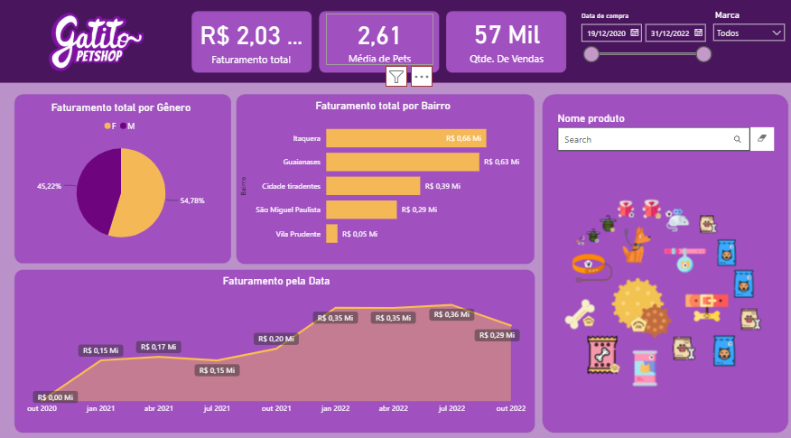

🐾 Gatito PetShop — Dashboard de Vendas

Projeto de Business Intelligence desenvolvido com Microsoft Power BI

Visão geral

O Gatito PetShop é um projeto de Business Intelligence desenvolvido para transformar dados de clientes, produtos e vendas em informações visuais e indicadores gerenciais.

O dashboard permite acompanhar o desempenho comercial, analisar o perfil dos clientes e explorar o faturamento por diferentes dimensões.

> Projeto desenvolvido em contexto educacional, com dados fictícios para fins de aprendizagem e demonstração de habilidades em análise de dados.

Objetivos do projeto

- Analisar o faturamento e o volume de vendas.
- Identificar padrões de consumo.
- Compreender a distribuição de clientes por perfil e localização.
- Acompanhar o desempenho das vendas ao longo do tempo.
- Criar indicadores para apoiar a tomada de decisão.

Tecnologias utilizadas

- Microsoft Power BI: desenvolvimento do dashboard.
- Power Query (Linguagem M): extração, transformação e preparação dos dados.
- DAX: criação de colunas calculadas e medidas.
- Excel:fonte de dados das vendas.
- TXT/CSV:fonte de dados dos clientes.
- Google Sheets / Web: fonte de dados dos produtos.

Processo de ETL

Foram utilizadas três fontes de dados:

| Fonte | Origem |
|---|---|
| Clientes | Arquivo TXT |
| Vendas | Arquivos Excel organizados em pasta |
| Produtos | Google Sheets publicado na Web |

No Power Query foram realizadas etapas de importação, combinação de arquivos, promoção de cabeçalhos, ajuste de tipos de dados, remoção de colunas e filtragem de registros sem identificador de cliente.

Modelagem de dados

O modelo utiliza três tabelas:

- Clientes: informações cadastrais e perfil dos consumidores.
- Produtos: identificação, categoria, marca, valor e URL das imagens.
- Vendas:transações, datas, produtos, consumidores e quantidades.

Relacionamentos ativos:

- Clientes (1) → (*) Vendas.
- Produtos (1) → (*) Vendas.
Cálculos DAX

Valor unitário
dax
Valor_unitario = RELATED(Produtos[Valor])

Faturamento por venda
dax
Faturamento = 'Vendas'[Quantidade] * 'Vendas'[Valor_unitario]

Faturamento total
dax
Faturamento total = SUM('Vendas'[Faturamento])

Indicadores e visualizações

O dashboard apresenta:

- Média de pets por cliente.
- Quantidade total de itens vendidos.
- Faturamento total.
- Faturamento por gênero.
- Faturamento por bairro.
- Evolução do faturamento ao longo do tempo.
- Visualização de produtos por imagem.
- Filtros por marca, período e nome do produto.

Visualização do projeto

Estrutura do repositório

text
Dashboard-Gatito-PetShop/
│
├── README.md
├── Dashboard_Gatito_PetShop.pbix
│
├── docs/
│   └── Documentacao_Tecnica.pdf
│
└── images/
    └── dashboard.png

Documentação

A documentação técnica complementar está disponível na pasta docs, com detalhes sobre as fontes, transformações, modelagem, cálculos e visualizações.

Aprendizados e competências desenvolvidas

- Integração de fontes de dados distintas.
- ETL com Power Query.
- Modelagem relacional.
- Criação de cálculos com DAX.
- Desenvolvimento de dashboards interativos.
- Organização e comunicação visual de indicadores.

Projeto de portfólio — Business Intelligence | Power BI